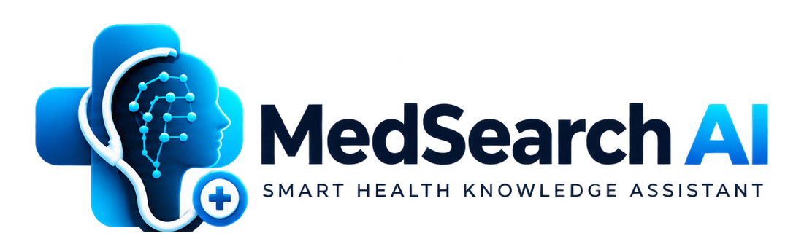

MedSearch AI

Intelligent Medical Knowledge Retrieval & RAG Assistant

  <strong>Making Medical Information Easier to Understand Through AI</strong>

  An AI-powered medical knowledge retrieval platform that combines Retrieval-Augmented Generation (RAG), semantic search, and locally hosted Large Language Models to help users understand medical information.

  

⸻

Overview

MedSearch AI is an intelligent medical knowledge retrieval and assistance platform designed to simplify access to medical information.

The application uses Retrieval-Augmented Generation (RAG) to retrieve relevant information from medical documents and knowledge sources before generating context-aware responses.

Users can upload medical reports, explore medical information, understand laboratory results, compare reports, and receive responses supported by relevant source information.

The platform combines a modern web interface with a Python-based backend and locally hosted AI models to create an integrated medical information assistant.

Project Focus: Artificial Intelligence | Data Science | Natural Language Processing | Large Language Models | Retrieval-Augmented Generation

⸻

Key Features

1. AI-Powered Medical Chat

* Ask questions about medical information.
* Generate context-aware responses using RAG.
* Retrieve relevant information from indexed documents.
* Provide evidence-oriented answers with source references.
* Handle insufficient evidence rather than relying on unsupported answers.

2. Medical Report Analysis

* Upload medical reports in PDF format.
* Extract and process document content.
* Generate simplified explanations of medical information.
* Help users understand laboratory measurements and report findings.

3. Intelligent Medical Search

* Search across indexed medical knowledge.
* Retrieve relevant document passages.
* Use semantic retrieval to identify contextually related information.

4. Report Comparison

* Compare information across medical reports.
* Identify changes in reported measurements.
* Support easier understanding of report differences over time.

5. Personal Medical Library

* Organize uploaded medical documents.
* Access previously uploaded reports.
* Keep medical documents organized for future reference.

6. User Authentication

* User registration and login.
* Authentication-based access.
* Protected application pages.
* User-oriented document management.

7. Analytics Dashboard

* Centralized dashboard.
* Medical document overview.
* Report and activity insights.

⸻

Technology Stack

Category	Technologies
Frontend	Next.js, React, TypeScript
Styling	Tailwind CSS
Backend	Python, FastAPI
AI / LLM	Ollama, Phi
AI Architecture	Retrieval-Augmented Generation (RAG)
NLP	Text Processing, Semantic Search
Embeddings	Sentence Transformers
Vector Database	ChromaDB
Retrieval	Vector Similarity Search
PDF Processing	Python PDF Processing Libraries
Authentication	JWT-based Authentication
Development Tools	VS Code, Git, GitHub

⸻

System Architecture

MedSearch AI follows a modular architecture that connects the frontend, backend, document-processing pipeline, retrieval system, and language model.

                 USER
                   |
                   v
          NEXT.JS FRONTEND
                   |
                   v
             FASTAPI BACKEND
                   |
          +--------+---------+
          |                  |
          v                  v
    USER AUTHENTICATION   DOCUMENT UPLOAD
                             |
                             v
                    PDF TEXT EXTRACTION
                             |
                             v
                       TEXT CHUNKING
                             |
                             v
                    TEXT EMBEDDINGS
                             |
                             v
                       VECTOR STORE
                         ChromaDB
                             |
                             v
                     SEMANTIC RETRIEVAL
                             |
                             v
                    RELEVANT CONTEXT
                             |
                             v
                    LOCAL LLM - OLLAMA
                             |
                             v
                   EVIDENCE-BASED RESPONSE
                             |
                             v
                           USER

⸻

How RAG Works

MedSearch AI uses Retrieval-Augmented Generation to improve the relevance of AI-generated responses.

Step 1 — Document Ingestion

Medical PDF documents are uploaded and their text content is extracted.

Step 2 — Text Chunking

Extracted content is divided into smaller, manageable text segments.

Step 3 — Embedding Generation

The text segments are converted into numerical vector representations using an embedding model.

Step 4 — Vector Storage

Generated embeddings and associated document information are stored in the vector database.

Step 5 — Semantic Retrieval

When a user submits a question, the system searches for relevant information from the indexed content.

Step 6 — Response Generation

The retrieved context is passed to the locally hosted language model through Ollama.

Step 7 — Evidence-Based Answer

The system generates a context-aware response using the retrieved information and provides supporting source references where available.

⸻

Project Structure

MedSearch-AI/
│
├── backend/
│   └── app/
│       ├── api/
│       │   └── auth.py
│       ├── core/
│       │   └── security.py
│       ├── database/
│       │   └── connection.py
│       ├── models/
│       │   └── user.py
│       ├── schemas/
│       │   └── auth.py
│       ├── services/
│       │   ├── document_service.py
│       │   └── report_service.py
│       └── main.py
│
├── frontend/
│   ├── app/
│   │   ├── analytics/
│   │   ├── dashboard/
│   │   ├── documents/
│   │   ├── login/
│   │   ├── reports/
│   │   ├── report-comparison/
│   │   ├── search/
│   │   ├── signup/
│   │   └── workspace/
│   ├── components/
│   ├── lib/
│   └── public/
│
├── rag/
│   ├── generation/
│   │   ├── evidence.py
│   │   └── llm.py
│   ├── ingestion/
│   │   ├── chunker.py
│   │   └── loader.py
│   ├── retrieval/
│   │   ├── search.py
│   │   └── vector_store.py
│   ├── index_documents.py
│   └── index_medical_knowledge.py
│
├── data/
│   └── medical_knowledge/
│
├── .gitignore
└── README.md

⸻

Installation & Setup

Prerequisites

Install the following before running the application:

* Python 3.12+
* Node.js and npm
* Ollama
* Git

1. Clone the Repository

git clone https://github.com/haaazziy/MedSearch-Intelligent-RAG.git
cd MedSearch-Intelligent-RAG

2. Backend Setup

Create and activate a virtual environment:

cd backend
python3 -m venv .venv
source .venv/bin/activate

Install the backend dependencies using the project’s dependency file:

pip install -r requirements.txt

Return to the project root:

cd ..

3. Configure Ollama

Install Ollama and download the model:

ollama pull phi

Start Ollama:

ollama serve

Make sure the selected model is available locally before running the AI generation pipeline.

4. Frontend Setup

Open another terminal at the project root and execute:

cd frontend
npm install

Start the development server:

npm run dev

Open the application:

http://localhost:3000

5. Start the Backend

From the project root, activate the backend environment:

cd backend
source .venv/bin/activate

Start FastAPI:

uvicorn app.main:app --reload

Backend API:

http://127.0.0.1:8000

API documentation:

http://127.0.0.1:8000/docs

Note: The installation commands assume the backend has a requirements.txt file and that the required environment configuration is provided. Configure database settings and other required environment variables before starting the application.

⸻

Screenshots

Add application screenshots here to demonstrate the user interface.

Application	Preview
Landing Page	Add landing page screenshot
Dashboard	Add dashboard screenshot
Medical Chat	Add chat screenshot
Report Analysis	Add report analysis screenshot
Medical Search	Add search screenshot

⸻

Security & Privacy

MedSearch AI is designed with privacy-conscious development principles.

* Local LLM execution through Ollama.
* Authentication-based application access.
* Environment-based configuration for sensitive credentials.
* Git exclusions for local environment files and uploaded documents.
* User-oriented document management.

Important: This is an educational and development project. It is not a certified medical device or a substitute for professional medical advice, diagnosis, or treatment. AI-generated information may be incomplete or incorrect. Users should consult qualified healthcare professionals for medical decisions.

⸻

Future Enhancements

* Advanced hybrid search combining keyword and vector retrieval.
* Medical entity extraction and recognition.
* Intelligent document reranking.
* Evidence strength scoring.
* Advanced RAG evaluation dashboard.
* Retrieval metrics including Precision@K, Recall@K, MRR, and NDCG.
* Answer evaluation using faithfulness and citation accuracy.
* Medical report trend analysis.
* Improved multilingual medical assistance.
* Progressive Web App (PWA) enhancements.

⸻

Project Goals

The primary goal of MedSearch AI is to explore how modern AI technologies can make complex medical information easier to access and understand.

This project demonstrates the practical integration of:

* Data Science
* Natural Language Processing
* Large Language Models
* Retrieval-Augmented Generation
* Vector Databases
* Full-Stack Web Development
* AI-Powered Information Retrieval

⸻

Author

Hasil Salam M A

Data Science | AI & Machine Learning | Full-Stack Development

GitHub: https://github.com/haaazziy

⸻

Repository

MedSearch AI — Intelligent Medical Knowledge Retrieval & RAG Assistant

https://github.com/haaazziy/MedSearch-Intelligent-RAG

⸻

  <strong>MedSearch AI</strong> 
  Intelligent Medical Knowledge Retrieval Powered by AI

